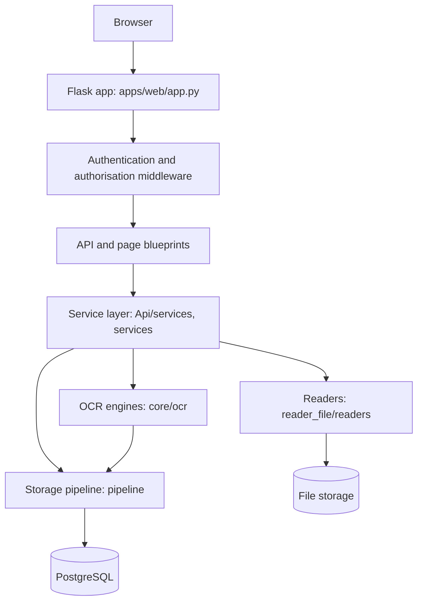
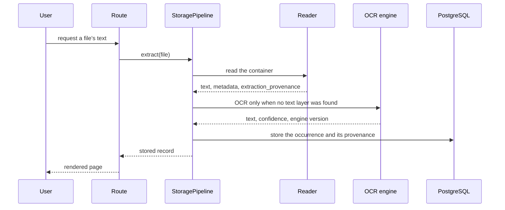
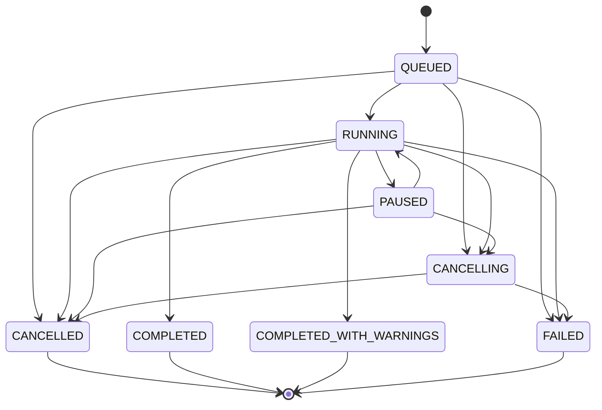

# Architecture

How the application is put together, in the order a request travels. The
diagrams are checked against the code they depict - the job state machine below
is compared with `services.jobs.job_state.TRANSITIONS` on every run, so a state
that the code gains or loses without the diagram following fails the suite.

## Request path

## A read, end to end

## Job lifecycle

Every long operation is a job with a state, and the states are a closed set: a
job that leaves `QUEUED` reaches exactly one of the terminal states, and every
terminal state releases its lock and its workers.

## Layers, and what may not cross them

| layer | may import | may not |
|---|---|---|
| templates | nothing (rendered by Flask) | read the database, decide access |
| routes (`Api/routes`, blueprints) | services | import a reader directly |
| services | readers, pipeline, database | render markup |
| readers | their own libraries | write to the database |
| core | the standard library and its own subpackages | import a route or a service |
