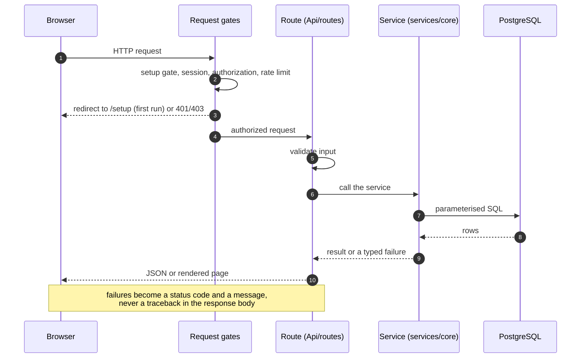
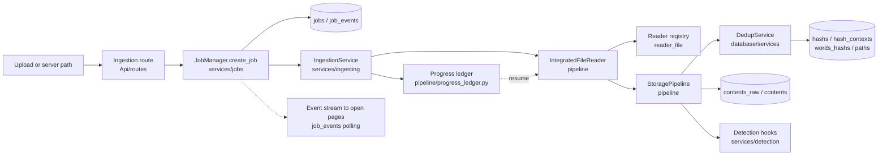
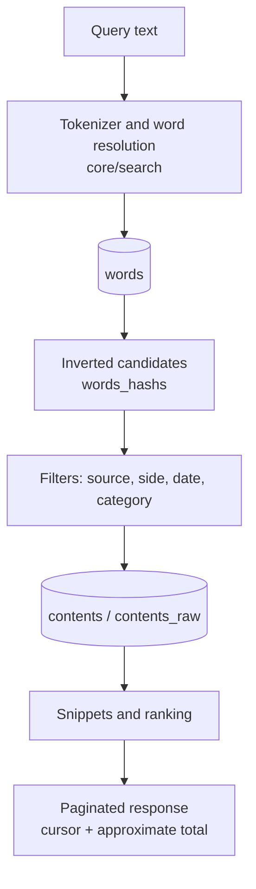
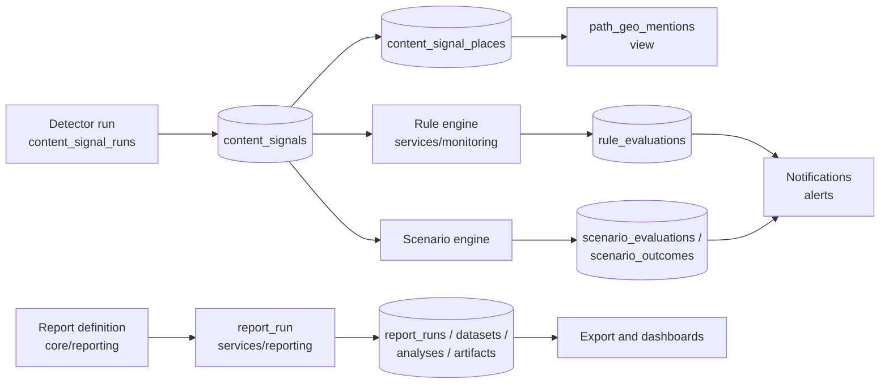
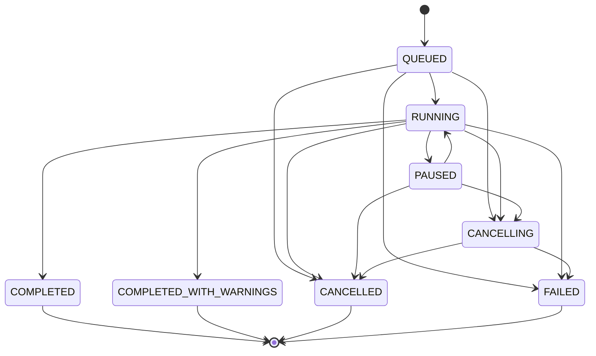
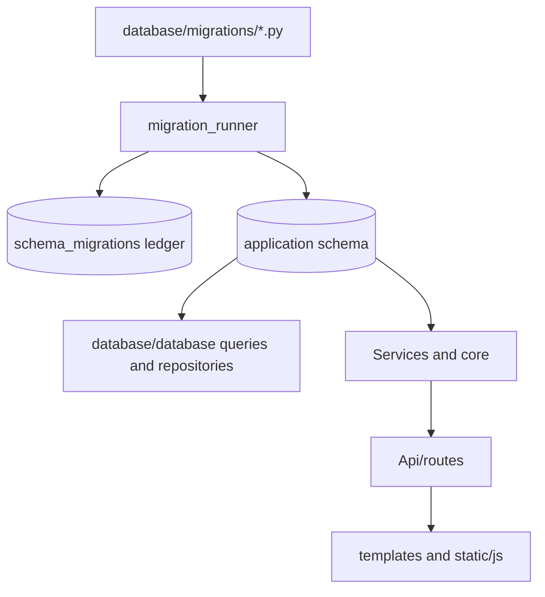

# Architecture

What SYLTHARAE is made of today, how a request and a job travel through it, and
which component owns each decision. Every diagram and figure below describes the
code in this repository; the job-state diagram is verified against
`services/jobs/job_state.py` by `tests/unit/test_architecture_diagrams.py`.

## Shape of the application

A single Flask application (`apps/web/app.py`) serving server-rendered pages
plus a JSON API. PostgreSQL holds all state; the filesystem holds the ingested
bytes and the runtime data directory. Long-running work — ingestion, detection,
geo extraction, rule and scenario evaluation, report runs, retention — is not
done in the request; it is queued through the job system and observed through
its event stream.

```
Browser
  │  HTTP(S)
  ▼
Reverse proxy (deploy/nginx/syltharae.conf)  ── TLS, static files, request limits
  │
  ▼
WSGI server (flask built-in, or waitress when WSGI_SERVER=waitress)
  │
  ▼
Flask application  apps/web/app.py
  ├── before_request gates: setup gate, auth/session, authorization, rate limit
  ├── blueprints          Api/routes/*.py            (pages + JSON API)
  ├── services layer      Api/services, services/*   (work, no HTTP concerns)
  ├── core                core/*                     (domain logic and registries)
  ├── pipeline            pipeline/*                 (read → extract → store)
  ├── database            database/*                 (bootstrap, migrations, queries)
  └── templates + static  templates/*, static/*      (UI)
```

### Layers and what each owns

| Layer | Location | Responsibility |
| --- | --- | --- |
| Web application | `apps/web/app.py`, `apps/web/deployment.py`, `run_web.py` | Application object, blueprint registration, request gates, error handling, release information, start-up checks. |
| Routes | `Api/routes/*.py` | HTTP contract only: parse and validate input, authorize, call a service, shape the response, translate failures into status codes. |
| API services | `Api/services/*.py` | Composing a route's work: search assembly, export, file library queries. |
| Domain services | `services/*` | Ingestion, detection, monitoring rules and scenarios, reporting, geo, importing, jobs. This is where the application's behaviour lives. |
| Core | `core/*` | Registries and invariants: interfaces, experience contracts, search model, security, monitoring, reporting definitions, path safety, initialization, installer. |
| Pipeline | `pipeline/*` | The read → extract → store path for a file, with the progress ledger that makes interruption resumable. |
| Database | `database/*` | Schema bootstrap and migrations, connection configuration, query and repository helpers, the deduplication service. |
| Interface | `templates/*`, `static/*` | Jinja templates and the JavaScript modules behind them. The interface registry describes each navigable screen; the experience layer declares its contract. |

The dependency direction is one-way: routes depend on services, services on
core and database, core on database and the standard library. Core and services
never import a route.

### Registries as the single source of truth

Three registries keep the application honest about what it exposes, and each is
generated or checked against code rather than maintained by hand:

* **Interface registry** (`core/interfaces/`) — every navigable screen, its
  route, its domain and its lifecycle. `docs/INTERFACE_REGISTRY.md` is generated
  from it, and `tests/unit/test_interface_registry.py` pins the agreement.
* **Action registry** (`core/experience/action_registry.py`) — what a user can
  do, the permission and confirmation each action needs. The action-surface
  audit (`python3 -m core.experience.action_audit`) measures how much of the UI
  still acts outside it.
* **Experience contracts** (`core/experience/contract.py`) — what each screen
  presents: columns, filters, actions, states, help key.

`docs/EXPERIENCE_CONTRACT.md`, `docs/ACTION_SURFACE_AUDIT.md` and
`docs/SCREEN_INSPECTOR_EVIDENCE.md` are generated from those modules and
compared with them by tests, so a count in the documentation cannot drift from
the product.

## Request path



Gate order matters and is deliberate: the **setup gate** (`Api/routes/setup.py`,
registered before every other route) sends a request to the installation wizard
while the system is uninitialized, so a fresh install cannot half-serve an
application that has no schema. Behind it, the session/auth layer and the
authorization decorators decide access, and rate limiting and lockouts are
accounted against the real client address — which is why `TRUSTED_PROXY_COUNT`
must be set correctly behind a proxy
(`apps/web/deployment.py`, [CONFIGURATION.md](CONFIGURATION.md)).

## Data flows

### Ingestion



Content identity is derived, not assigned: the file's bytes produce a **hash**,
the hash plus source and side produce a **context**, and paths hang off the
context. That is why the schema keys content-derived rows by `hash_id`, and why
the same file ingested twice from two locations is one content with two
occurrences rather than two contents. `database/services/dedup_service.py`
enforces it with `ON CONFLICT` on the unique keys rather than by application
checks, so a race cannot create a duplicate.

### Search



Word resolution is a `word = ANY(...)` lookup against `words_word_key`, not a
pattern scan; the measurement that decided this is recorded in
`docs/perf/CAPACITY_REPORT.md`. Counting is explicit about what it costs: the
pagination mode (`exact`, `timed`, `skip`) is part of the response, so a client
can tell an approximate total from a counted one.

### Detection, monitoring and reporting



Detection is versioned by run: `content_signal_runs` records which detector saw
what, so a re-run supersedes rather than mutates. Rule and scenario evaluation
produce append-only outcomes, and `report_artifacts` carries a checksum and byte
size with a trigger that verifies both — reporting history is immutable by
construction, not by convention. Place mentions are read through the
`path_geo_mentions` **view**, which merges detector signals with the legacy
`path_geo_mentions_m0015` rows for content the places detector has not covered.

## The job system

Jobs are the application's execution model for anything slow: ingestion, geo
extraction, detection re-runs, rule and scenario evaluation, report runs,
retention. `services/jobs/manager.py` owns the lifecycle, `repository.py` owns
persistence, and `job_state.py` owns the vocabulary and the permitted
transitions.



**A state is not an event.** The states above are the job's condition; the
events in `job_state.EVENT_TYPES` are what the job *reports* while it is in
them, and they are a different vocabulary with different members
(`FILE_DISCOVERED`, `TEXT_EXTRACTED`, `OCR_COMPLETED`, `ARCHIVE_EXTRACTED`,
`DUPLICATE_DETECTED`, `FILE_PROCESSING`, `FILE_COMPLETED`, `FILE_FAILED`,
`FILE_SKIPPED`, `PHASE_STARTED`, `PHASE_COMPLETED`, `DATABASE_WRITE`,
`PROGRESS`, `WARNING`, `ERROR`, and the lifecycle events `JOB_CREATED`,
`JOB_STARTED`, `JOB_PAUSED`, `JOB_CANCELLED`, `JOB_COMPLETED`, `FAILED`). A job
in `RUNNING` emits `PROGRESS` many times and `FILE_COMPLETED` once per file;
neither is a state. Both vocabularies are enforced in the schema since m0039
(`ck_jobs_status`, `ck_job_events_event_type`), generated from
`services/jobs/job_state.py` at migration time, and
`tests/unit/test_job_event_vocabulary.py` checks that every event type the
manager publishes is in the vocabulary.

Terminal states are absorbing: `COMPLETED`, `COMPLETED_WITH_WARNINGS`,
`CANCELLED` and `FAILED` have no outgoing transition, which is what makes a
finished job's record final. Cancellation is cooperative — `CANCELLING` is a
requested state that the running work acknowledges by reaching `CANCELLED` — so
a stuck worker is visible as a job left in `CANCELLING` rather than one that
silently reports itself cancelled.

The manager runs each job on a worker thread bounded by
`JobsConfig.max_concurrent_jobs`, publishes events through an event throttle
(high-frequency events are sampled, and the sample threshold is a configuration
value), and persists them through `JobRepository.add_event`. Open pages follow a
job by reading `job_events`; the stream is a database read, so a page reload
never loses the history.

## Database

PostgreSQL is the only store, and **`database/migrations/` plus the
`schema_migrations` ledger define the schema**. `database/SYLTHARAE.sql` is a
historical schema-only snapshot and is not a deployment authority
([DATABASE.md](DATABASE.md)). `database/bootstrap.py` is the single supported
path to create or upgrade a schema: `ensure_database`, `bootstrap_database` and
`schema_status`; each migration runs in its own transaction and is recorded as
it is applied, so a failure leaves the schema untouched and the ledger honest.



The content model is three levels — `hashs` (bytes), `hash_contexts` (bytes in
a source and side) and `paths` (occurrences) — with `contents` holding the
search representation and `contents_raw` the verbatim text. Relationships are
declared, not implied: 66 foreign keys, all validated, with per-relationship
deletion behaviour (`CASCADE` where a child cannot outlive its parent, `SET
NULL` where provenance must survive, `RESTRICT` where a reference must be
resolved first). The database audit's findings and the evidence for each are in
`docs/database/` ([FINAL_INTEGRITY_REPORT.md](database/FINAL_INTEGRITY_REPORT.md)).

## Security

Authentication, sessions, authorization, rate limiting, lockouts, CSRF,
security headers and the audit trail live in `core/security/` and
`apps/web/app.py`; the policy the application actually serves is documented in
[SECURITY.md](SECURITY.md). Two properties are structural rather than
configured:

* **historical records are immutable** — report artifacts, report runs in a
  terminal state and the analyst categorization log are protected by database
  triggers, so a correction is a new record and never an edit;
* **every query is parameterised** — a query that interpolates a value into SQL
  is treated as a defect, `core/sql_safety.py` and `core/path_safety.py` exist to
  make the safe form the easy one.

## Deployment

`run_web.py` is the entry point; `deploy/` carries the supported shape — a
`systemd` unit that runs the application and an `nginx` site that terminates
TLS, serves `/static/`, applies request limits and forwards to the app with the
proxy headers the application is told to trust. Start-up checks in
`apps/web/deployment.py` refuse to start on an invalid configuration and warn on
an unsafe one. Offline and air-gapped installation is supported by the bundle
under `offline-bundle/`; the installer never requires the network.

## Testing

The suite is layered the same way the application is: unit tests for core,
services and the registries; integration tests against a **disposable
PostgreSQL** built by running the real migrations (`tests/conftest.py`); security
tests for authorization and disclosure; and document tests that regenerate each
generated artifact and compare it with the committed file. A test that needs a
database skips only when none can be reached, and `REQUIRE_POSTGRES=1` turns
that skip into a failure for CI.
