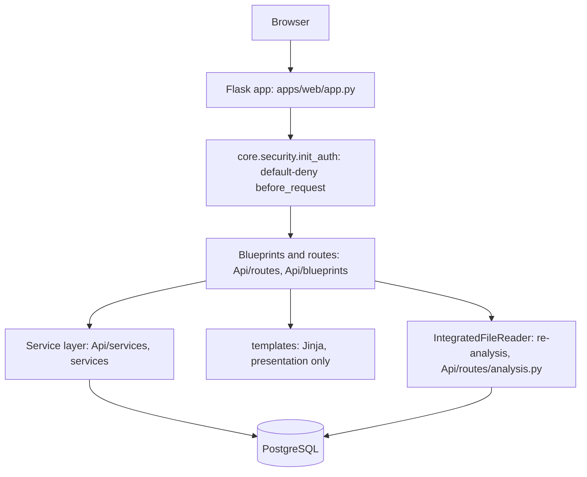
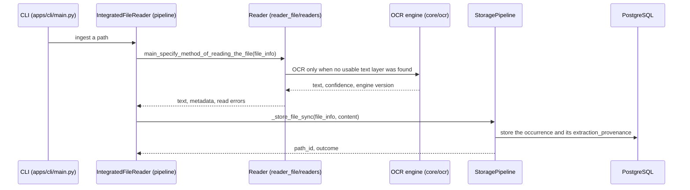
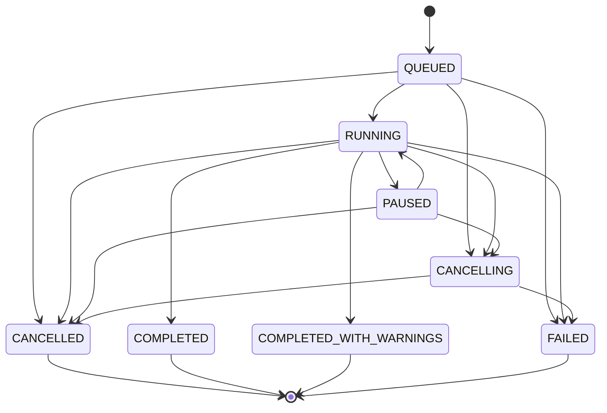

# Architecture

How the application is put together, in the order a request travels, and what
an ingestion does. Every claim below is traced to code by
`tests/unit/test_architecture_claims.py` (paths, layers, and the two
sequences) and by `tests/unit/test_architecture_diagrams.py` (the job state
machine against `services.jobs.job_state.TRANSITIONS` and
`TERMINAL_STATES`) - a state the code gains or loses without the diagram
following fails the suite.

Two diagrams, two different journeys. They used to be one: a sequence that
began with a web request and ended with `StoragePipeline.extract(file)`. That
was wrong twice - no route or blueprint imports `StoragePipeline`, and the
class has no method named `extract` - so the read path and the ingestion path
are now drawn separately, each from the code that actually runs.

## Request path

A read of stored text answers from the database and reads no file: the
file-content endpoints return what ingestion already stored. One route does
run ingestion - `Api/routes/analysis.py` re-processes selected paths through
`IntegratedFileReader` - and that is the only place the web layer reaches the
pipeline. It reaches it directly, not through the service layer, so the
layers table below records it as an exception rather than pretending the
route is a service.

## Ingestion, end to end

OCR is called by the readers that need it (`read_img_fast.py`, `read_pdf.py`
import `get_ocr_engine` and `recognize_best` from `core.ocr`); the pipeline
records what the reader reported in `extraction_provenance.ocr` and calls no
engine itself. Readers write only what a container has to be unpacked into
(the e-mail reader materialises attachments); they never write to the
database.

## Job lifecycle

Every long operation is a job with a state, and the states are a closed set: a
job that leaves `QUEUED` reaches exactly one of the terminal states, and every
terminal state releases its lock and its workers.

## Layers, and what may not cross them

| layer | may import | may not | measured |
|---|---|---|---|
| templates | nothing (rendered by Flask) | read the database, decide access | held: no `` of a Python module exists |
| routes (`Api/routes`, `Api/blueprints`) | services, `Api.utils` | import a reader directly | held: 0 imports of `reader_file`; **not held for the pipeline: `Api/routes/analysis.py` imports `IntegratedFileReader`** |
| services | readers, pipeline, database | render markup | held: no `render_template` in `services/` |
| readers | their own libraries, `core` | write to the database | held: 0 imports of `database` |
| core | the standard library and its own subpackages | import a route or a service | **not held: three modules in `core/` import `Api.utils` and `Api.services`** |

The exceptions are recorded rather than hidden, and each is pinned by name in
`tests/unit/test_architecture_claims.py::KNOWN_LAYER_VIOLATIONS` so that a new
one fails the suite and the list cannot quietly grow:

| violator | imports | count |
|---|---|---|
| `core/monitoring/notification_display.py` | `Api.utils` | 1 |
| `core/monitoring/notification_service.py` | `Api.utils` | 6 |
| `core/search/retrieval.py` | `Api.utils` | 1 |
| `core/search/session.py` | `Api.utils` | 1 |
| `core/search/words.py` | `Api.utils` | 1 |
| `Api/routes/analysis.py` | `pipeline.integrated_reader` | 2 |

## Documented by

| claim | code | test |
|---|---|---|
| the web app is `apps/web/app.py` | `apps/web/app.py` | `test_architecture_claims.py` |
| auth is default-deny | `core.security.init_auth` | same |
| job states and edges | `services.jobs.job_state` | `test_architecture_diagrams.py` |
| the layer rules above | the import graph | `test_architecture_claims.py` |
| OCR field list | `StoragePipeline._ocr_provenance` | `test_ocr_provenance_docs.py` |

Reviewed by: repository owner (the same owner who holds the translation
decision due 2026-11-05). Last reviewed: 2026-10-29, against the import graph
and `apps/web/app.py` at that commit.
